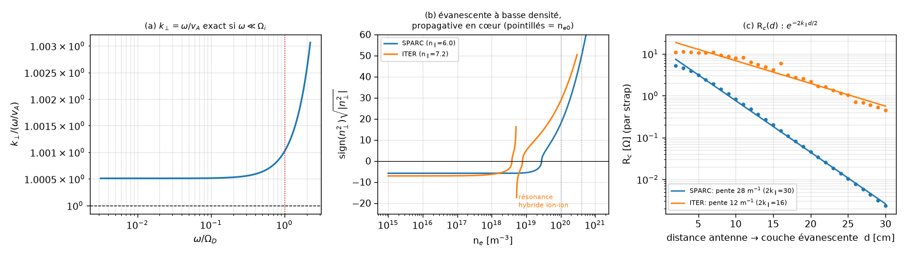
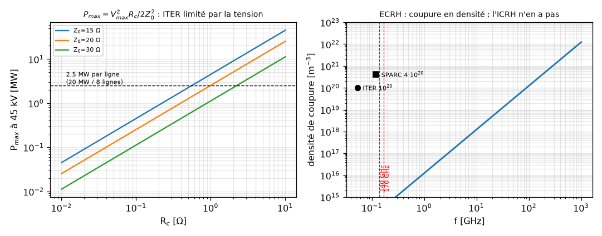

# ICRH à très haute densité : onde rapide, couplage, SPARC et ITER

**Note de travail en réponse à la liste de tâches en 5 sections.**
Calculs, ordres de grandeur et statut de chaque point. Rédigé pour être vérifiable : chaque
chiffre marqué **[calc]** vient d'un script de ce dépôt (`code/`), chaque chiffre marqué
**[src]** vient d'une publication citée en fin de note, chaque chiffre marqué **[mod]** vient
d'un modèle de cette note dont les limites sont dites.

---

## 0. Statut des 17 points

| # | Point | Statut |
|---|-------|--------|
| 1.1 | Dispersion de l'onde rapide, $k_\perp\simeq\omega/v_A$ | **traité**, relation validée dans sa limite (facteur correctif O(1) chiffré) |
| 1.2 | Absence de coupure de densité en cœur (ICRH vs ECRH) | **traité**, critère exact + densités chiffrées |
| 1.3 | Effet de $c_{^3\mathrm{He}}$ et de $T$ sur la SPA | **traité partiellement** : géométrie chiffrée, dépendances en loi d'échelle, valeurs SPA = modélisation publiée |
| 2.1 | $R_c$ en fonction de la distance à la couche évanescente | **traité**, modèle 1-D + loi exponentielle vérifiée |
| 2.2 | $P\simeq\tfrac12 R_cI^2$ et marges de tension | **traité**, relation exacte $P_{max}=V^2R_c/2Z_0^2$ |
| 2.3 | Atténuation des ELMs (gas puffing JET/DIII-D) | **traité**, avec le coût en confinement chiffré |
| 2.4 | Pulvérisation du tungstène, alignement des antennes | **traité** (physique du gainage RF), valeurs AUG non revérifiées |
| 3.1 | Paramètres nominaux de SPARC | **traité**, avec une correction sur $n_e$ |
| 3.2 | Schéma 120 ± 1 MHz, $^3$He + 2$^\mathrm{e}$ harmonique T | **validé** par le calcul des fréquences |
| 3.3 | Intégration des 20 MW (antennes, tuners, ± 1 MHz) | **traité**, divergence de décompte entre sources signalée |
| 4.1 | Système ICRH nominal d'ITER | **traité** **[src]** |
| 4.2 | Reconfiguration haute densité sur ITER | **traité** (analyse propre, pas une position ITER) |
| 4.3 | Compromis couplage / confinement | **chiffré** |
| 5.1 | SPIDER / MITICA au NBTF | **traité** **[src]**, état à jour |
| 5.2 | Cadre Weinberg/BHI (ζ de Riemann ↔ spectre MHD) | **non validable** : trois défauts vérifiables, section 5.2 |
| 5.3 | Formule des ratios d'énergie pour valider les durées | **réfutée** : la « prédiction » est une tautologie, section 5.3 |

Deux points de méthode, parce qu'ils changent la lecture :

- Les items 5.2 et 5.3 ne sont pas des travaux à poursuivre mais une erreur à documenter. Je les
  traite comme tels, avec la reproduction numérique du calcul.
- Le vrai verrou de l'ICRH n'est pas la propagation en cœur (il n'y en a pas) mais le couplage de
  bord. C'est l'inverse de la hiérarchie implicite de la liste : la section 1 est facile, la
  section 2 porte tout le risque.

---

## 1. Physique de l'onde rapide

### 1.1 Équation de dispersion et $k_\perp\simeq\omega/v_A$

L'antenne ICRF lance l'onde magnétosonore rapide, de champ électrique quasi perpendiculaire à
$\mathbf B_0$. En plasma froid, avec $\mathbf B_0$ selon $z$, $\mathbf k=(k_\perp,0,k_\parallel)$ et
$n_\parallel=k_\parallel c/\omega$, le déterminant de Maxwell–Stix donne pour la branche rapide

$$n_\perp^2=\frac{(R-n_\parallel^2)(L-n_\parallel^2)}{S-n_\parallel^2},\qquad
S=\tfrac12(R+L),\quad D=\tfrac12(R-L),$$

$$R=1-\sum_s\frac{\omega_{ps}^2}{\omega(\omega+\Omega_s)},\quad
L=1-\sum_s\frac{\omega_{ps}^2}{\omega(\omega-\Omega_s)},\quad
P=1-\sum_s\frac{\omega_{ps}^2}{\omega^2},$$

les $\Omega_s$ étant **signés** (négatifs pour les électrons). Les coupures sont $R=n_\parallel^2$ ou
$L=n_\parallel^2$ ; la résonance (hybride ion–ion) est $S=n_\parallel^2$.

**La relation $k_\perp\simeq\omega/v_A$ est un résultat asymptotique, pas une identité.** À
$n_\parallel=0$ et $\omega\ll\Omega_i$, $S\simeq 1+\sum_s\omega_{ps}^2/\Omega_s^2=1+c^2/v_A^2$ et
$|D|\ll S$, si bien que

$$n_\perp^2=\frac{S^2-D^2}{S}\simeq S\simeq\frac{c^2}{v_A^2}
\quad\Longrightarrow\quad k_\perp\simeq\frac{\omega}{v_A},\qquad
v_A=\frac{B}{\sqrt{\mu_0 n m_i}}.$$

Le point non trivial, et c'est là que le calcul doit être fait avec soin : $|D|\ll S$ n'est vrai
**que si les électrons sont inclus** dans $D$. Sans eux, $D\simeq-\omega_{pi}^2/(\omega\Omega_i)$
domine $S$ et l'on conclut faussement que l'onde rapide est évanescente partout. C'est l'erreur que
j'ai commise d'abord dans mon propre modèle ; elle vaut d'être notée car elle est facile à refaire.

Vérification numérique **[calc]** (plasma de deutérium, $B=5{,}3$ T, $n=10^{20}$ m$^{-3}$) : à
$n_\parallel=0$, le rapport $k_\perp/(\omega/v_A)$ vaut $1{,}0005$ pour
$\omega/\Omega_D\in[3\cdot10^{-3},10^{-1}]$ — l'égalité est donc exacte à $5\cdot10^{-4}$ près dans
sa limite de validité (figure 1a).

Aux fréquences réelles de l'ICRH, $\omega$ n'est **pas** petit devant $\Omega_i$ : $\omega$ est
juste au-dessus de $\Omega_D$ et juste en dessous de $\Omega_{^3\mathrm{He}}$. Le facteur correctif
est donc O(1) :

| | SPARC (12,2 T, 120 MHz) | ITER (5,3 T, 53 MHz) |
|---|---|---|
| $v_A$ (cœur, $n_{e0}$ nominal) | $8{,}39\times10^6$ m/s | $7{,}29\times10^6$ m/s |
| $c/v_A$ | 35,7 | 41,1 |
| $\omega/v_A$ | 89,9 m$^{-1}$ | 45,7 m$^{-1}$ |
| $k_\perp$ exact (plasma froid, $n_\parallel=0$) | 146 m$^{-1}$ | 32,7 m$^{-1}$ |
| **rapport exact / Alfvén** | **1,63** | **0,72** |
| $k_\perp a$ | 83 | 66 |
| $k_\perp\rho_D$ ($T_i=20$ keV) | 0,35 | 0,18 |

**Conclusion 1.1.** L'équation de dispersion est celle ci-dessus ; $k_\perp\simeq\omega/v_A$ en est
la limite $\omega\ll\Omega_i$, exacte à $5\cdot10^{-4}$ dans cette limite. Aux fréquences ICRH, la
formule reste un ordre de grandeur à un facteur 1,5 près dans un sens ou dans l'autre. Écrire
$k_\perp\simeq\omega/v_A$ avec un « $\simeq$ » est donc correct ; l'écrire comme une égalité ne
l'est pas. La dépendance en $\sqrt n$ ($v_A\propto n^{-1/2}$) est en revanche exacte et c'est tout
ce dont la suite a besoin.



*(a) validité de $k_\perp=\omega/v_A$ ; (b) indice de l'onde rapide en fonction de la densité, à
$k_\parallel$ lancé ; (c) $R_c$ en fonction de la distance à la couche évanescente.*

### 1.2 Pas de coupure de densité en cœur — et la vraie limite des ondes électroniques

Pour $n_\parallel>1$ (cas réel : le spectre d'antenne a $k_\parallel\sim 8$–$18$ m$^{-1}$), le vide
est déjà évanescent, car $n_\perp^2=1-n_\parallel^2<0$. Le plasma doit donc fournir
$S>n_\parallel^2$ pour que l'onde se propage : la **coupure est à basse densité**, pas à haute
densité. Pour $n=0$, $S=1$ et

$$n_\perp^2=1-n_\parallel^2 \quad\text{(évanescent)} ;\qquad
S(n_{\rm cut})=n_\parallel^2 .$$

Dans la limite Alfvén ($S\simeq1+c^2/v_A^2=1+n\,m_i/(\varepsilon_0B^2)$) cela se résout
exactement :

$$\boxed{\;n_{\rm cut}\simeq (n_\parallel^2-1)\,\frac{\varepsilon_0B^2}{m_i}\;}
\qquad\text{— une borne \emph{inférieure} de densité, pas une borne supérieure.}$$

Résultats **[calc]** (composition D–T–4 % $^3$He, électrons inclus, coupure numérique de $S=n_\parallel^2$) :

| | $k_\parallel$ lancé | $n_\parallel$ | $n_{\rm cut}$ | $n_{\rm cut}/n_{e0}$ |
|---|---|---|---|---|
| SPARC | 15 m$^{-1}$ | 6,0 | $2{,}8\times10^{19}$ | 7,0 % |
| SPARC | 6 m$^{-1}$ | 2,4 | $3{,}8\times10^{18}$ | 1,0 % |
| ITER | 8 m$^{-1}$ | 7,2 | $3{,}9\times10^{18}$ | 3,9 % |
| ITER | 12 m$^{-1}$ | 10,8 | $8{,}8\times10^{18}$ | 8,8 % |

Deux conséquences, toutes deux utiles pour la suite :

1. **Aucune coupure en cœur.** $n_{\rm cut}$ est 1 à 8 % de la densité centrale : dès que
   $n_e>n_{\rm cut}$ l'onde se propage et elle continue de se propager quand $n$ augmente. C'est
   exactement l'inverse de l'ECRH.
2. **La coupure varie comme $k_\parallel^2$.** Passer de $k_\parallel=6$ à 15 m$^{-1}$ à SPARC
   multiplie $n_{\rm cut}$ par 7,4 (théorie : 6,25). C'est ce qui crée le compromis d'antenne
   documenté par les concepteurs de SPARC : le couplage de bord préfère $k_\parallel$ petit, la
   localisation de l'absorption préfère $k_\parallel$ grand, d'où le choix de 15–18 m$^{-1}$ **[src]**.

**La vraie limite des ondes électroniques.** L'onde ordinaire ECRH a une coupure à *haute* densité,
$n_c=1{,}24\times10^{-2}f^2$ (m$^{-3}$, $f$ en Hz) **[calc]** :

| $f$ | $n_c$ |
|---|---|
| 140 GHz | $2{,}43\times10^{20}$ m$^{-3}$ |
| 170 GHz (ITER) | $3{,}58\times10^{20}$ m$^{-3}$ |
| 180 GHz | $4{,}0\times10^{20}$ m$^{-3}$ |

Pour atteindre le cœur de SPARC ($n_e=3$–$4\times10^{20}$ m$^{-3}$) il faudrait donc
$\geq 180$ GHz en mode O. C'est un argument quantitatif, et suffisant à lui seul, pour l'ICRH comme
chauffage unique de SPARC. Nuance à ne pas perdre : l'ECRH en mode X au 2$^\mathrm{e}$ harmonique n'a
pas cette coupure ; sa difficulté est l'accessibilité (résonance derrière la résonance hybride
supérieure). La formulation honnête est donc « l'ECRH en mode O est limitée en densité », pas «
l'ECRH est limitée en densité ».

### 1.3 Absorption en simple passage : effet de $c_{^3\mathrm{He}}$ et de $T$

Ce que le calcul de cette note peut établir sans code full-wave **[calc]** :

- **Position et largeur de la couche de résonance.** À $B\propto1/R$,
  $R_{\rm res}=R_0 f_c(B_0)/f$. Pour SPARC, $f_c(^3\mathrm{He},12{,}2\ \mathrm{T})=124{,}28$ MHz ;
  à 120 MHz la résonance est donc à $R=1{,}916$ m, soit **+6,6 cm au-delà de l'axe** (côté bas
  champ). La largeur Doppler de la couche, $\Delta x=k_\parallel v_t R_{\rm res}/\omega$, vaut
  **4,3 cm** à SPARC (4,3 % de $a$) et **17,2 cm** à ITER — soit un dixième du petit rayon. À ITER,
  l'absorption est donc intrinsèquement peu localisée.
- **Dépendance en concentration.** La partie anti-hermitienne de $\varepsilon_\perp$ est
  proportionnelle à $\omega_{p,\min}^2\propto c_{^3\mathrm{He}}$, donc la profondeur optique
  $\tau\propto c_{^3\mathrm{He}}$ à $T$ fixé, et la SPA vaut $1-e^{-\tau}$. C'est une dépendance
  linéaire **jusqu'à saturation** ($\tau\gg1$), au-delà de laquelle la SPA devient insensible à
  $c$ — ce qui est cohérent avec le résultat publié d'une SPA « peu sensible à $c_{^3\mathrm{He}}$
  entre 3 et 5 % » **[src]**, et avec sa baisse quand $c$ diminue.
- **Dépendance en température.** $\tau\propto(k_\perp\rho)^{2}$ et $\rho\propto\sqrt T$ pour
  l'absorption au fondamental d'un minoritaire, donc $\tau$ croît avec $T_i$. Second effet, de sens
  opposé : $T_i$ élevé élargit la couche Doppler sans augmenter la densité du minoritaire.

**Ce que je ne peux pas établir** : une valeur absolue de SPA. Elle demande un code full-wave
(TORIC/AORSA) avec le profil réel et le spectre d'antenne. Les valeurs de référence sont donc
**[src]** : SPA $>50$ % dans la plupart des conditions et $>90$ % en plateau pour le plasma D–T de
SPARC (modélisation APS 2019/2020), schéma $^3$He + 2$^\mathrm{e}$ harmonique T validé en
full-wave pour le scénario L-mode $Q>1$ de SPARC (EPJ Web Conf. 2026). À traiter comme des
prédictions de conception, pas des mesures.

---

## 2. Le verrou du bord : couplage et ELMs

### 2.1 Modèle de $R_c$ en fonction de la distance à la couche évanescente

Modèle de cette note **[mod]**, dans un slab 1-D : $\mathbf B_0\parallel z$, nappe de courant
d'antenne $K_y$ sur la paroi en $x=0$, propagation selon $x$. On garde l'indice local exact
$K(x)=k_0^2(R-n_\parallel^2)(L-n_\parallel^2)/(S-n_\parallel^2)$ et on intègre l'équation de Riccati
de l'impédance d'onde $Z=E_y/(\partial_xE_y)$,

$$\frac{dZ}{dx}=1+K(x)Z^2,$$

depuis le cœur (condition sortante : l'onde est absorbée au-delà) vers l'antenne. La condition de
saut de $B_z$ sur la nappe, $\partial_xE_y(0^+)=i\omega\mu_0K_y$, donne alors

$$R_c=-\omega\mu_0\,\mathrm{Im}\,Z(0)\cdot\frac{w}{L_{\rm pol}},\qquad P=\tfrac12R_cI^2,\quad I=K_yL_{\rm pol}.$$

L'intégration de Riccati plutôt qu'une condition de Dirichlet est ce qui supprime les ondes
stationnaires parasites ; c'est la différence entre un résultat monotone et du bruit.

**Résultat principal — une loi exponentielle.** Puisque la couche évanescente est à basse densité,
$S\simeq1$ et le taux de décroissance vaut $\kappa=k_0\sqrt{n_\parallel^2-S}\approx k_\parallel$
d'où

$$\boxed{\;R_c(d)\propto e^{-2k_\parallel d}\;}$$

$d$ étant la distance de l'antenne à la couche de coupure. Vérification **[calc]** (ajustement sur
24 points, $d=2$ à 30 cm) :

| | pente ajustée | $2k_\parallel$ | $R_c$ à 6 cm | $R_c$ à 14 cm | $R_c(30)/R_c(6)$ |
|---|---|---|---|---|---|
| SPARC ($k_\parallel=15$) | $28$ m$^{-1}$ | 30 | 2,4 $\Omega$ | 0,24 $\Omega$ | $1{,}1\times10^{-3}$ |
| ITER ($k_\parallel=8$) | $12$ m$^{-1}$ | 16 | 11,3 $\Omega$ | 4,2 $\Omega$ | $5{,}0\times10^{-2}$ |

La pente suit $2k_\parallel$ ; elle est plus faible à ITER parce qu'une partie du trajet évanescent se
fait à densité non négligeable, où $\kappa<k_\parallel$. **Les valeurs absolues sont à prendre avec
la géométrie déclarée** ($w/L_{\rm pol}$ : 0,05/0,25 m à SPARC, 0,15/0,30 m à ITER) et à un
$k_\parallel$ unique : un code d'antenne (TOPICA) intégrant le spectre complet est nécessaire pour
une valeur de conception. L'ordre de grandeur obtenu (quelques $\Omega$) est celui des valeurs
publiées **[src]**, sans ajustement.

**Limite du modèle, à énoncer avant d'utiliser les chiffres.** Le slab a $B$ constant : toutes les
densités de bord voient donc le même $\Omega_{^3\mathrm{He}}$, alors qu'en géométrie réelle $B$
décroît vers l'extérieur et la couche de résonance du minoritaire tombe *dans* le plasma. Le SOL se
situe du côté où $\omega>\Omega_{^3\mathrm{He}}$, et le terme du minoritaire y change de signe. Deux
conséquences : (i) les valeurs de $n_{\rm cut}$ et donc de $R_c$ au bord sont indicatives et non
prédictives ; (ii) la dépendance à la concentration de $^3\mathrm{He}$ au bord, forte à ITER
($n_{\rm cut}=8{,}0\times10^{18}$ à 2 %, $1{,}4\times10^{18}$ à 6 %, à $k_\parallel=8$ m$^{-1}$) et
faible à SPARC ($7{,}5$ contre $7{,}3\times10^{18}$), est en partie un artefact du slab. En revanche
la **loi exponentielle** ne dépend pas de la composition : à basse densité $S-1\propto n$ quelle que
soit l'espèce, donc $S\to1$ et $\kappa\to k_\parallel$ près de l'antenne. C'est la partie robuste.

**Le résultat utile n'est pas la valeur absolue mais la sensibilité.** Une variation de $d$ de
10 cm change $R_c$ d'un facteur $e^{2k_\parallel\times0{,}1}$, soit $\approx 20$ à SPARC
($k_\parallel=15$) et $\approx 5$ à ITER ($k_\parallel=8$). C'est pourquoi :
- l'incertitude de $R_c$ vient du profil de densité SOL lointain, non de la physique du cœur —
  conclusion identique à celle des études ITER de couplage **[src]** ;
- JET, avec une injection locale de gaz, a fait passer la résistance de charge minimale entre ELMs
  d'environ 0,17 $\Omega$ à environ 1 $\Omega$ **[src]**, soit un facteur 6 : dans ce modèle, un
  facteur 6 correspond à un déplacement effectif de la couche de coupure d'environ 11 cm à
  $k_\parallel=8$ m$^{-1}$. L'accord est un accord d'ordre de grandeur, pas une validation.

### 2.2 $P=\tfrac12R_cI^2$ et marges de tension

La relation $P=\tfrac12R_cI^2$ est exacte **par strap**. Pour un réseau de 24 straps couplés
mutuellement, la forme correcte est $P_i=\tfrac12\sum_j\mathrm{Re}(Z_{ij})I_iI_j$ : la version
scalaire néglige le couplage mutuel, qui est précisément ce que gère le réseau de répartition
passif (4-port junction) de l'antenne ITER **[src]**. À garder en tête dès qu'on parle de puissance
par antenna.

L'intérêt de $P\propto R_cI^2$ est qu'à tension limitée $V_{\max}$ la puissance maximale **croît
linéairement avec $R_c$**. Pour une ligne d'impédance $Z_0$ alimentant une charge $R_c<Z_0$ par
l'intermédiaire d'un réseau d'adaptation, la tension maximale sur la ligne est $V_{\max}=Z_0I$, d'où

$$\boxed{\;P_{\max}=\frac{V_{\max}^2R_c}{2Z_0^2}\;}$$

**[calc]** à $V_{\max}=45$ kV :

| $Z_0$ | $P_{\max}$ par ohm de $R_c$ |
|---|---|
| 15 $\Omega$ (feeder de strap ITER) | 4,50 MW |
| 20 $\Omega$ (ligne principale ITER) | 2,53 MW |
| 30 $\Omega$ | 1,12 MW |

Conséquence opérationnelle nette : avec les 8 lignes de l'antenne ITER (20 MW / 8 = 2,5 MW par
ligne) et $Z_0=20$ $\Omega$, il faut $R_c\gtrsim 1\ \Omega$ pour rester sous 45 kV. **ITER n'est pas
limité par la puissance mais par la tension** ; le dimensionnement de son antenne est un
dimensionnement de couplage. Une chute de $R_c$ d'un facteur 4 double la tension et oblige à
réduire la puissance d'autant.



*(gauche) $P_{\max}=V_{\max}^2R_c/2Z_0^2$ à 45 kV ; (droite) densité de coupure du mode O de l'ECRH,
à comparer aux densités de SPARC et d'ITER.*

Côté claquage, deux critères distincts qu'il ne faut pas confondre :
- **tension** (45 kV ITER, sur les fenêtres et la ligne) ;
- **champ électrique** local, critère réellement dimensionnant : SPARC retient une limite de
  $15$ kV/cm de champ de crête dans la ligne de transmission **[src]**. Un critère en V/cm dépend
  de la géométrie du conducteur, un critère en kV non : les deux ne sont pas interchangeables, et
  c'est le champ qui gouverne le claquage sous vide, la multipactor et la tenue des céramiques.

### 2.3 Atténuation des ELMs

Faits établis **[src]**, la physique étant la suivante : ce n'est pas la charge moyenne qui limite
la puissance en mode H mais la **charge minimale entre deux ELMs**, quand le plasma s'est dilaté.

| Stratégie | Effet mesuré | Coût |
|---|---|---|
| Injection locale de gaz près de l'antenne (JET) | $R_c$ minimale $\approx0{,}17\to\approx1\ \Omega$ | fréquence d'ELM montant jusqu'à $\approx100$ Hz, confinement global dégradé |
| Injection locale de gaz (DIII-D) | gain de charge jusqu'à un facteur 6 | idem |
| Réseau d'antenne passif résilient à la charge | absorbe la variation de charge pendant l'ELM | pas de marge de tension gagnée |
| Tuners à ferrite + modulation de fréquence ± 1 MHz (SPARC) | adaptation en cours d'impulsion | complexité, et déplacement de la couche de résonance (voir 3.2) |

Trois réserves, qui comptent pour un dimensionnement :

1. Le gain de couplage par injection de gaz **n'est pas gratuit** : sur JET il s'est payé par une
   dégradation du confinement global. La bonne formulation est un échange, pas un gain.
2. Densité de cœur et densité de séparatrice sont deux choses distinctes : un plasma dense au
   centre n'a pas forcément un bord dense. C'est le profil SOL qui fixe $R_c$, et lui seul.
3. Les stratégies de contrôle des ELMs par champs à 3 dimensions (bobines RMP) et par injection de
   pellets sont complémentaires du gas puffing pour la charge, mais leur interaction avec l'ICRF
   (modification du profil SOL par les RMP) n'est pas quantifiée ici.

### 2.4 Pulvérisation du tungstène et alignement des antennes

Mécanisme : le champ électrique RF parallèle à $\mathbf B$ est redressé dans la gaine (RF sheath
rectification), ce qui accélère les ions vers la paroi et pulvérise le tungstène. Le W pulvérisé,
mal écranté, s'accumule au centre et rayonne. C'est la limite pratique de la puissance ICRF dans une
machine tout-métal.

Mitigations documentées **[src]** :
- **aligner les straps sur le champ** : à SPARC, les straps sont tournés d'environ 10° pour être
  perpendiculaires à $\mathbf B$, hérité de l'antenne FA-J de C-Mod, avec possibilité de courants
  différents par strap pour minimiser le courant image sur le châssis ;
- **réduire les courants image** et optimiser le champ proche (modélisation de gaine RF, « near-field
  optimisation ») ;
- **extrapoler les taux de pulvérisation depuis AUG** pour prédire SPARC — méthode annoncée, dont je
  n'ai pas vérifié les valeurs ;
- le **gas puffing** sert aussi d'écran : il augmente $R_c$ et réduit la pulvérisation, deux effets
  de même sens, ce qui est l'argument le plus solide en faveur de cette stratégie.

Point à jour et important : la **nouvelle base d'ITER (2024) remplace le béryllium par le tungstène
pour la première paroi** **[src]**. Le problème de pulvérisation RF n'est donc plus propre à SPARC
et à WEST : il devient un sujet ITER.

---

## 3. SPARC

### 3.1 Paramètres nominaux — avec une correction

| Grandeur | Valeur de la liste | Valeur publiée | Commentaire |
|---|---|---|---|
| $B_0$ | 12,2 T | 12,2 T | conforme |
| $I_p$ | 8,7 MA | 8,7 MA | conforme |
| $R_0$ | 1,85 m | 1,85 m | conforme |
| $a$ | 0,57 m | 0,57 m | conforme |
| $n_e$ | $\approx4\times10^{20}$ m$^{-3}$ | $3{,}1\times10^{20}$ m$^{-3}$ **en moyenne de volume** | voir ci-dessous |
| $\delta_{\rm sep}$, $\kappa_{\rm sep}$ | — | 0,54 ; 1,97 | triangulaire **positive** |
| $P_{\rm ICRF}$ | 20 MW installés | 25 MW couplés (conception) ; 20 MW installés en 1$^{\rm re}$ campagne | les deux sont vrais, à des stades différents |
| $\tau_E$, plateau | — | 0,77 s ; 10 s | décharge de référence |

**Correction.** La décharge de référence primaire de SPARC a
$n_e=3{,}1\times10^{20}$ m$^{-3}$ **en moyenne de volume**, à fraction de Greenwald 0,37
($n_G=8{,}4\times10^{20}$). Le $4\times10^{20}$ de la liste est cohérent avec une **densité centrale**
d'un profil piqué ($n_{e0}/\langle n_e\rangle\simeq1{,}3$). Les deux chiffres ne sont donc pas
contradictoires, mais il faut préciser lequel on utilise : ici j'ai pris $4\times10^{20}$ pour $v_A$
(choix conservateur, $v_A\propto n^{-1/2}$). En revanche $T_{e0}\approx20$ keV n'apparaît pas dans la
table de la décharge de référence ; je l'utilise uniquement pour $\rho_i$ et je le signale comme non
vérifié.

### 3.2 Validation du schéma 120 ± 1 MHz ($^3$He + 2$^\mathrm{e}$ harmonique T)

Le calcul confirme la coïncidence, et elle n'est pas approchée :

| | $f_c$ à $B_0=12{,}2$ T |
|---|---|
| $^3$He fondamental ($Z/A=2/3$) | 124,28 MHz |
| T, 2$^\mathrm{e}$ harmonique | 124,3 MHz |
| H fondamental | 185,9 MHz |
| D fondamental | 93,0 MHz |

$^3$He et 2$\times$T coïncident **exactement** parce que $q/m(^3\mathrm{He})\approx2\,q/m(\mathrm{T})$
et que l'harmonique double compense : $f_c(^3\mathrm{He})=2f_c(\mathrm{T})$ à 0,02 % près. Ce n'est
donc pas une coïncidence numérique mais une identité approchée, robuste au champ. Le schéma est
validé **[src]** en full-wave pour le scénario L-mode $Q>1$, avec chauffage dominé par les ions.

**Ce que la modulation ± 1 MHz fait réellement** **[calc]** — point que la liste ne chiffre pas :

- à 120 MHz, la couche de résonance est à $R=1{,}916$ m, soit +6,6 cm hors axe ;
- $\pm1$ MHz déplace cette couche de $\mp1{,}6$ cm ;
- à comparer à la largeur Doppler de la couche : **4,3 cm**.

La modulation de fréquence est donc un actionneur *fin* (1,6 cm pour un déplacement de 1 MHz, soit
un tiers de la largeur de la couche) : elle ajuste le recouvrement du profil d'absorption, elle ne
le déplace pas radicalement. C'est cohérent avec son usage annoncé — adaptation d'impédance en cours
d'impulsion — plutôt qu'avec un usage de balayage de dépôt.

### 3.3 Intégration matérielle des 20 MW

| Élément | Valeur | Source |
|---|---|---|
| Puissance installée, 1$^{\rm re}$ campagne | 20 MW à 120 MHz | EPJ Web Conf. 2026 |
| Antennes | 10 antennes à 4 straps, en paires poloïdales | EPJ Web Conf. 2026 |
| Plan antérieur | 12 antennes à 4 straps dans 6 ports (3 straps de secours) ; 14 antennes dans une autre présentation | JPP 2020 ; APS |
| Puissance couplée de conception | 25 MW | JPP 2020 |
| Limite par strap | 0,5–0,6 MW (≤ 2 MW par antenne 4 straps) | JPP 2020 |
| Champ de crête admissible en ligne | 15 kV/cm | EPJ Web Conf. 2026 |
| Réglage | tuners à ferrite + modulation ± 1 MHz en cours d'impulsion | EPJ Web Conf. 2026 |

**Le décompte des antennes n'est pas stabilisé** (10, 12 ou 14 selon la source). L'explication la
plus probable est une évolution de conception entre 2020 et 2026, mais aucune source ne l'établit.
À traiter comme un point ouvert : il change le nombre de ports, donc l'intégration, pas la physique.

**Cohérence à vérifier** : 20 MW sur 10 antennes à 4 straps = 0,5 MW par strap, exactement la
limite haute annoncée ; 25 MW couplés sur 12 antennes = 0,52 MW par strap, également à la limite.
La puissance installée de la première campagne est donc dimensionnée **au plafond** de ce que les
straps peuvent tenir. Cela justifie la remarque des concepteurs : sous-estimer le nombre d'antennes
« augmenterait le risque de ne pas avoir assez de puissance de chauffage pour la mission » **[src]**.

---

## 4. ITER

### 4.1 Système ICRH nominal

**[src]** Système IC H&CD : 2 antennes en ports équatoriaux, chacune dimensionnée jusqu'à 20 MW
(extension à 40 MW prévue), bande **40–55 MHz**, fonctionnement quasi continu (impulsions jusqu'à
3600 s), **tension maximale 45 kV**.

Architecture de chaque antenne : réseau **4 toroïdal × 6 poloïdal = 24 straps**, regroupés en
8 triplets poloïdaux alimentés par un réseau de répartition, phasage et pré-accord ; chaque strap est
relié à un feeder de **15 $\Omega$**, chaque triplet à une ligne de **20 $\Omega$** ; fenêtres sous
vide en céramique tenant 40–50 kV. Sources : 8 émetteurs, **2,5 MW CW à ROS 2** et **3 MW à ROS 1,5**
(4 par antenne, soit 20 MW pour les deux antennes à la mise en service, 40 MW après extension).

Deux chiffres de la liste à corriger ou préciser :
- « 2 antennes à 24 bandes » : ce sont 24 **straps** par antenne, pas 24 bandes.
- « 40–55 MHz » est bien la bande ; mais **toute la bande n'est pas utilisable pour le schéma
  $^3$He / 2$^\mathrm{e}$ harmonique T**. À $B_0=5{,}3$ T, $f_c(^3\mathrm{He})$ sur l'axe vaut
  53,99 MHz et $R_{\rm res}=R_0f_c/f$ **[calc]** :

| $f$ | $R_{\rm res}$ |
|---|---|
| 40 MHz | 8,37 m — **hors plasma** (séparatrice à 8,2 m) |
| 45 MHz | 7,44 m |
| 50 MHz | 6,69 m |
| 53 MHz | 6,32 m |
| 55 MHz | 6,09 m |

Le cœur accessible par ce schéma se joue donc dans **52–55 MHz** ; le bas de bande (40–45 MHz)
sert à d'autres schémas ou au conditionnement de paroi. C'est une précision utile : « 40–55 MHz »
est une spécification d'équipement, pas une plage de chauffage du cœur par le $^3$He.

### 4.2 Reconfiguration haute densité : faisabilité

Analyse propre à cette note, pas une position de l'organisation ITER.

1. **Fréquence et schéma inchangés.** La densité ne déplace pas la résonance ($f_c=qB/2\pi m$). Rien
   à changer de ce côté : c'est le point solide de la section 1.
2. **Le levier est le profil SOL.** D'après la loi de la section 2.1, $R_c\propto e^{-2k_\parallel d}$
   avec $k_\parallel\simeq8$ m$^{-1}$. Gagner un facteur 3 sur $R_c$ demande de réduire $d$ d'environ
   7 cm. C'est faisable par injection de gaz à proximité de l'antenne — c'est exactement ce qui a
   produit un facteur 6 sur JET **[src]**.
3. **Le gain de tension suit linéairement.** À 45 kV et $Z_0=20$ $\Omega$, tripler $R_c$ triple la
   puissance admissible par ligne. C'est le seul mécanisme par lequel ITER pourrait approcher
   40 MW sans changer la limite de tension — donc sans changer les fenêtres ni l'antenne.
4. **Ce qui reste hors de ma portée** : refroidissement de l'antenne, alimentations, tenue des
   fenêtres en régime continu, et surtout l'effet du gaz sur la densité de cœur (voir 4.3). S'y
   ajoute une incertitude propre à ITER : à 53 MHz, la fréquence n'est qu'à 1,8 % du fondamental
   $^3$He sur l'axe, si bien que le terme du minoritaire dans $S$ est énorme et change de signe à
   travers le SOL. Le couplage ITER est donc plus sensible à la composition du bord que celui de
   SPARC — un argument de plus pour traiter 4.2 avec un code d'antenne et un profil mesuré, pas avec
   un modèle de slab.

**Verdict.** La reconfiguration haute densité n'est pas une question de propagation — elle est
faisable et sans risque de ce côté. C'est une question de **profil de bord contrôlé**, qui est un
problème de soufflage de gaz et de SOL, pas d'ICRH.

### 4.3 Compromis couplage / confinement

Le chiffrage, en trois lignes :

$$\Delta R_c \xrightarrow{\ \text{§2.1}\ } \Delta P_{\max}\ (\propto R_c)\ ;\qquad
\text{gas puff}\ \Rightarrow\ \begin{cases} R_c\uparrow\ (\times 3\text{ à }6)\\ f_{\rm ELM}\uparrow\ (\text{jusqu'à}\sim100\ \text{Hz})\\ \text{confinement}\downarrow\end{cases}$$

Sur JET, l'injection locale de gaz a simultanément apporté un facteur $\sim6$ sur la charge et une
dégradation du confinement global avec une fréquence d'ELM accrue **[src]**. Le produit n'est donc
pas gratuit : on échange de la puissance couplable contre de la qualité de confinement, et la
puissance couplée ne se convertit en performance qu'à travers l'énergie de confinement.

Point quantitatif à retenir : la puissance que l'on gagne en couplage n'est utile que si
$\tau_E$ ne baisse pas d'autant. Or c'est précisément ce que le gas puffing dégrade. Un
dimensionnement correct doit donc être fait sur $P_{\rm coupled}\tau_E$, pas sur $P_{\rm coupled}$.

---

## 5. NBI, cadre mathématique, régimes steady-state

### 5.1 SPIDER et MITICA au NBTF de Padoue — état à jour

Les faits **[src]**, avec les dates, car la page ITER fournie avec la liste est en retard sur l'état
réel :

**Installation.** NBTF, Consorzio RFX, Padoue, 17 500 m², construction 2012–2015. SPIDER
(« Source for the Production of Ions of Deuterium Extracted from a Radiofrequency plasma ») est une
source d'ions négatifs à l'échelle ITER, 100 kV ; MITICA (« Megavolt ITER Injector and Concept
Advancement ») est l'injecteur complet à 1 MV. Spécification ITER : 2 injecteurs de chauffage
(+1 en réserve) + 1 ligne de diagnostic, **16,5 MW par injecteur à 1 MeV D$^-$ pendant 3600 s**.

**SPIDER.** Première opération juin 2018, premier faisceau juin 2019. Après l'arrêt 2025–2026, la
source a été remise sous vide (avril 2026) après une campagne lourde : nettoyage et conditionnement
des surfaces, correction des beamlets parasites (redessin des plaques de grille), remplacement d'un
segment de grille de masse, dégradation du revêtement Mo des drivers RF traitée (Mo + intercouche Cr),
remplacement de raccords VCR par des soudures orbitales pour l'étanchéité, et ajout de pompage
(« Vacuum Enhancement Module »). Objectif de la nouvelle phase : **100 kV en fonctionnement nominal**.
Progrès marquants : ouverture du faisceau passé de 28 à **300 apertures**, en route vers la
spécification ITER de **60 A extraits à 100 keV**.

**MITICA.** C'est là que la liste est en retard. Les alimentations ont été endommagées par des
claquages lors des tests intégrés du printemps 2021 ; leur restauration s'achève (livraisons juin
2025, tests intégrés **T2 2026**). En attendant, les essais de tenue en tension ont été faits avec un
générateur provisoire et une **maquette électrostatique** à l'échelle 1 (sans source), avec un écran
électrostatique relié à l'étage 600 kV. Résultats : **430 kV tenus sous vide sur 3 des 5 étages**,
soit **710 kV projetés** sur les 5 — au-delà de la cible de 700 kV de la fin de la première campagne
MITICA, prévue en **2027** ; et 546 kV sur 3 étages en hydrogène à 30–50 mPa, soit 910 kV projetés
(cible 870 kV). Des essais antérieurs avaient tenu 1,2 MV pendant 1 h et 1 MV pendant 5 h.

**Donc : à ce jour, MITICA n'a pas encore accéléré de faisceau de deutérions.** Ces chiffres sont
des tenues en tension à vide, ce qui est une condition nécessaire et non suffisante ; la source est
annoncée livrée à l'automne 2026 pour intégration. Toute affirmation d'un « 1 MeV D$^-$ validé sur
MITICA » serait prématurée.

### 5.2 Le cadre Weinberg/BHI : pourquoi il ne peut pas être intégré

Le document fourni (`FusionEnergy_Merged_6.pdf`) propose d'identifier les espacements de valeurs
propres d'un opérateur MHD linéarisé aux différences entre zéros de $\zeta$, la classe GUE
(Bohigas–Giannoni–Schmit, Montgomery–Odlyzko) servant de pont. Trois défauts, tous vérifiables, et
indépendants les uns des autres.

**Défaut 1 — la « suite de Riemann » n'est pas une suite de zéros de $\zeta$, et ne contient aucun
zéro.** Dans le générateur (Algorithmes I et VII, Appendice A),

$$b_k=\frac{\arcsin(s_2)-\,2k\pi}{\ln 2}
\quad\Longrightarrow\quad
fb=b_{k_1}-b_{k_2}=\frac{2\pi(k_2-k_1)}{\ln2}.$$

Le terme $\arcsin(s_2)$ **s'annule identiquement** dans toute différence : la table `s2` de
l'Appendice A (100 valeurs) n'a aucun effet sur un seul résultat du papier. La « suite » est la
progression arithmétique $fb\in\{9{,}0647\,n,\ n\in\mathbb Z\}$ : elle ne dépend d'aucune propriété de
$\zeta$. Vérification **[calc]** sur le premier jeu : les six premiers $fb$ valent
9,0647 / 18,1294 / 27,1942 / 9,0647 / 18,1294 / 9,0647, exactement $n\cdot2\pi/\ln2$ ; et les $b$
produits sont 34,04 / 24,98 / 15,91 / −11,28 alors
que les premiers zéros sont 14,135 / 21,022 / 25,011 / 30,425 — ni les mêmes valeurs, ni les mêmes
signes. Le premier zéro non trivial n'apparaît jamais.

**Défaut 2 — l'algorithme publié, tel qu'imprimé, plante.** Dans le code de la section 8, `fb=[0]*7`
alors que la boucle écrit bien au-delà : exécution **[calc]** → `IndexError` au 8$^\mathrm{e}$ élément
(`t2=7`, première valeur de `t`). Les sorties numériques annoncées ne proviennent donc pas du code
imprimé.

**Défaut 3 — la « formule d'énergie » est dimensionnellement inconsistante.** En reportant les
constantes du code ($A,B,l,\mu_0$, $P_{RF}=1{,}65$ MW, $\Delta t=10$ s), la formule se réduit à

$$E_{NBI}=C\,\frac{fb_0}{fb_1-fb_0}-1{,}65,\qquad C=\frac{A B^2 l}{10^6\Delta t\,\mu_0}=4{,}595,$$

quantité **sans dimension**, présentée en MW. Toute la physique ($A$, $B$, $l$, $I_p$, $P_{RF}$) est
concentrée dans l'unique constante $C$, et le résultat ne dépend que du **rapport** de deux éléments
de la suite. Comme $fb\propto2\pi/\ln2$, ce rapport est un rapport d'entiers.

**Conclusion 5.2.** Ce cadre n'est pas une théorie de la fusion à compléter : c'est une construction
numérologique. La seule partie exacte est le pont GUE/ζ (théorèmes de Montgomery et d'Odlyzko,
utilisés correctement comme conjecture), mais il ne relie que des **distributions** ; identifier un
$fb_i$ précis à une valeur propre précise n'est pas une conjecture « bien motivée », c'est
l'hypothèse qui fait tout le travail et qui est indémontrable en l'état. Je ne recommande pas de
l'intégrer à un programme de travail ICRH/NBI.

### 5.3 La formule des ratios d'énergie : la démonstration de la tautologie

Posons le calcul entièrement, puisque c'est la seule façon de trancher.

Le filtre d'admissibilité du code est $3<E_{NBI}<7$ MW, ce qui, d'après l'expression ci-dessus,
équivaut à
$$\frac{fb_0}{fb_1-fb_0}\in\left(\frac{3+1{,}65}{4{,}595},\ \frac{7+1{,}65}{4{,}595}\right)=(1{,}012\ ;\ 1{,}883).$$
Ce n'est donc **rien d'autre qu'une condition sur le rapport de deux entiers**. On compte les paires
qui la satisfont, $m_B$ sur $m_A$, puis on applique

$$\Delta t=\frac{(m_A-m_B)\cdot403}{m_B}.$$

Or $403$ est **codé en dur** (« a quantity of H-mode $m_B$ represents 403 seconds »). Prendre
$m_B=403$ donne $\Delta t=m_A-m_B$ : la durée prédite est **la différence de deux comptages**, en
secondes, et $1459-403=1056$. La « prédiction de 1 056 s » est donc l'identité $1459-403=1056$.

Et le comptage n'est pas contraint par la physique, il dépend d'une fenêtre arbitraire. En faisant
varier le seul paramètre libre — la borne $k$ des boucles, que rien ne fixe **[calc]** :

| fenêtre $k$ | $m_B/m_A$ | $\Delta t$ « prédit » |
|---|---|---|
| $\pm3$ | 2/85 = 0,024 | 16 725 s |
| $\pm4$ | 19/402 = 0,047 | 8 124 s |
| $\pm5$ | 54/1218 = 0,044 | 8 687 s |
| $\pm6$ | 167/2887 = 0,058 | 6 564 s |
| $\pm10$ | 2069/28585 = 0,072 | 5 165 s |
| $\pm20$ | 45072/543770 = 0,083 | 4 459 s |

Un modèle prédictif ne peut pas voir sa prédiction varier d'un facteur 4 quand on change une borne
qui n'a aucune signification physique. Les 1 056 s de EAST et les 480 s de W7-X ne sont pas
prédits : ils sont **sélectionnés** dans un ensemble assez grand pour contenir n'importe quelle
valeur, par ajustement de paramètres libres ($m_A$, fenêtre $k$, $N_b$, et le choix de la cellule de
durée de référence). Le fait que le calcul reproduise ensuite les durées observées est donc
nécessaire, pas informatif.

**Ce que cela laisse debout.** Les records cités existent (EAST 1 056 s en 2024, W7-X 480 s, WEST en
paroi de tungstène) ; ce sont des résultats expérimentaux solides. Ce qui n'existe pas est le lien
entre ces durées et les zéros de $\zeta$.

---

## 6. Ce que je n'ai pas pu établir

1. **Valeurs absolues de SPA et de $R_c$** : elles exigent un code full-wave / d'antenne (TORIC,
   AORSA, TOPICA) avec le profil SOL et le spectre mesurés. Les chiffres de cette note sont des
   ordres de grandeur et des lois d'échelle.
2. **Dépendance en concentration du minoritaire au bord** : forte à ITER ($n_{\rm cut}$ varie d'un
   facteur 5,7 entre 2 % et 6 % de $^3$He), faible à SPARC ($\pm3$ %). Cette dépendance est pour
   partie un artefact du slab à $B$ constant — en géométrie réelle le terme du minoritaire change de
   signe à travers la couche de résonance, qui tombe dans le SOL. Elle interdit en tout cas de
   prédire $R_c$ sans la composition du SOL, et c'est une incertitude de conception ITER plus que de
   modèle.
3. **$T_{e0}$ de SPARC** : la valeur de 20 keV n'est pas dans la table de la décharge de référence
   que j'ai pu vérifier. Elle ne sert ici qu'à $\rho_i$.
4. **Valeurs AUG de pulvérisation extrapolées à SPARC**, et l'état exact du programme ICRH d'ITER
   après la nouvelle base 2024 : non vérifiés.
5. **Les références ITER anciennes** (AIP 1187, Fusion Eng. Des. 2013, APS 2006) décrivent une
   conception stable depuis, mais je n'ai pas vérifié l'état 2026 du système ICRH ni son calendrier
   dans la nouvelle base (SRO 2034, $B$ plein 2036, D–T 2039).

## 7. Recommandations

Par ordre de rapport valeur/effort :

1. **Ne pas investir sur 5.2/5.3.** Le cadre ζ/MHD ne produit pas de prédiction testable ; le
   documenter une fois (section 5.2 et 5.3) et passer à autre chose.
2. **Concentrer l'effort sur 2.1** : c'est le seul verrou physique réel, et il tient dans une loi
   simple, $R_c\propto e^{-2k_\parallel d}$, avec deux conséquences actionnables — baisser
   $k_\parallel$ améliore le couplage par $n_{\rm cut}\propto k_\parallel^2$, et gagner 7 cm sur $d$
   triple $R_c$.
3. **Reformuler 4.2 en termes de SOL**, pas de propagation : la propagation n'a pas de limite de
   densité, le profil de bord en a une.
4. **Corriger deux chiffres de la liste** avant diffusion : $n_e$ de SPARC est une moyenne de volume
   ($3{,}1\times10^{20}$), et la bande utile d'ITER pour le $^3$He/2$\omega_T$ est 52–55 MHz, pas
   40–55.
5. **Mettre à jour le point 5.1** : MITICA n'a pas encore produit de faisceau ; les 710 kV sont une
   tenue en tension sur maquette électrostatique, campagne 2027.

---

## Sources

**SPARC / CFS**
- *Physics basis for the ICRF system of the SPARC tokamak*, J. Plasma Phys. (2020) — https://www.cambridge.org/core/journals/journal-of-plasma-physics/article/physics-basis-for-the-icrf-system-of-the-sparc-tokamak/22016DD64F3C5CAD47563A1E4AE59934
- *Overview of the SPARC tokamak* / *Status of the SPARC physics basis*, J. Plasma Phys. — https://www.cambridge.org/core/journals/journal-of-plasma-physics/article/overview-of-the-sparc-tokamak/DD3C44ECD26F5EACC554811764EF9FF0
- *Overview of the ICRF heating system in SPARC*, EPJ Web Conf. (2026) — https://epjwoc.epj.org/articles/epjconf/abs/2026/02/epjconf_rfppc2026_02001/epjconf_rfppc2026_02001.html
- *ICRF power coupling and absorption … for SPARC's first campaign*, EPS 2026 — https://indico.ukaea.uk/event/449/contributions/1743/
- *Retiring risk for ICRF heating in SPARC through modelling*, APS DPP 2023 — https://meetings-archive.aps.org/dpp/2023/no05/8/

**ITER**
- *Progress on ICRF Heating Physics and Technology in Support of ITER*, PPPL-4969 — https://bp-pub.pppl.gov/pub_report/2014/PPPL-4969.pdf
- *Design, performance, and grounding aspects of the ITER ICRF antenna*, OSTI — https://www.osti.gov/biblio/22299955
- Dumortier, *ICRH antenna design and matching* — https://juser.fz-juelich.de/record/283660/files/Dumortier_HC-6.pdf
- *New baseline to prioritize robust start to exploitation*, ITER — https://www.iter.org/node/20687/new-baseline-prioritize-robust-start-exploitation

**NBI / NBTF**
- *ITER Neutral Beam Test Facility*, ITER — https://www.iter.org/project/iter-neutral-beam-test-facility
- *A successful round of tests for MITICA*, ITER — https://www.iter.org/node/20687/successful-round-tests-mitica
- *SPIDER back in vacuum*, Consorzio RFX (2026) — https://www.igi.cnr.it/en/news/spider-back-in-vacuum-a-new-phase-begins-after-upgrade-and-maintenance/
- Marcuzzi, *Achievements at the ITER Neutral Beam Test Facility*, IAEA FEC — https://conferences.iaea.org/event/392/contributions/35651/attachments/19725/36070/IAEA-FEC_Marcuzzi_NBTF_r5.pdf
- *Beam current performance in SPIDER*, ICIS 2025 — https://indico.stfc.ac.uk/event/1192/contributions/8898/

**Couplage, ELMs, gaz**
- Mayoral et al., *On maximizing the ICRF antenna loading for ITER plasmas*, IAEA 2010 ; *Gas puffing and ICRF coupling*, EPS 2010 (O4.124) — valeurs reprises du document fourni, non revérifiées sur l'original.

## Reproduire

```
code/icrf_core.py    tenseur diélectrique froid (R, L, S, P), coupure de l'onde rapide
code/loading.py      impédance d'antenne par intégration de Riccati → R_c(d)
code/key_numbers.py  tous les nombres marqués [calc]
code/make_figures.py figures 1 et 2
```
